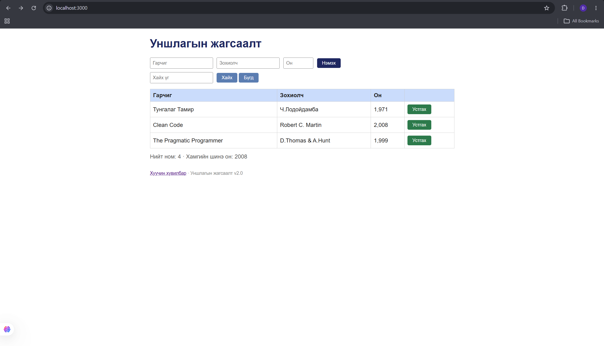

# BUG-01: Нийт номын тоолуур жагсаалтын тоотой зөрж байна

**Орчин:** Уншлагын жагсаалт v2.0, Chrome, Windows, 2026-11-25. Browser-ийн хувилбар тэмдэглэгдээгүй.

**Урьдчилсан нөхцөл:** Аппыг шинээр асаасан; жагсаалтад анхны 3 ном байна.

## Дахин гаргах алхам

1. `http://localhost:3000` хаягийг нээнэ.
2. Хүснэгтийн номын мөрүүдийг тоолно.
3. “Нийт ном” тоолуурын утгыг хүснэгтийн мөрийн тоотой харьцуулна.

**Хүлээгдэж байсан:** Хүснэгтэд байгаа 3 номын тоолуур `3` байна.

**Бодит үр дүн:** Хүснэгтэд 3 ном харагдаж байхад тоолуур `4` гэж харуулсан.

**Ноцтой байдал:** Minor — жагсаалтын бодит хэмжээг буруу мэдээлж байна.

**Хавсралт:** 

**Олдсон аялал:** Fed-Ex (өгөгдлийн урсгал)
