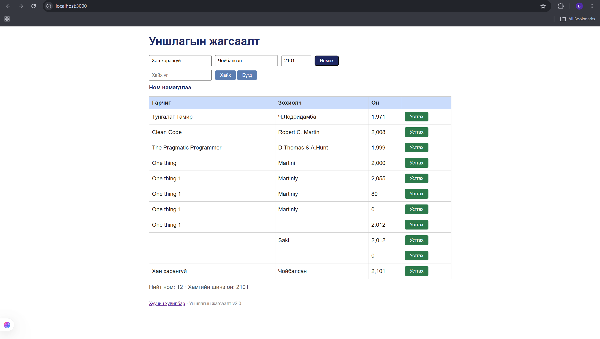
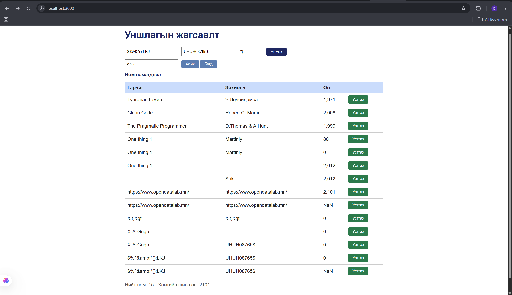

# BUG-02: Оны талбар бүхэл тоо болон зөвшөөрөгдөх хязгаарыг шалгахгүй байна

**Орчин:** Уншлагын жагсаалт v2.0, Chrome болон `curl.exe`, Windows, Node.js v24.22.1, 2026-11-25/26. Browser-ийн хувилбар тэмдэглэгдээгүй.

**Урьдчилсан нөхцөл:** Апп ажиллаж байна. UI болон API шалгалт тус бүрийг хийхдээ аппыг шинээр асааж анхны төлөвт оруулна.

## Дахин гаргах алхам

### UI шалгалт

1. `http://localhost:3000` хаягийг нээнэ.
2. Гарчиг, зохиолч бөглөж, оны талбарт `2101` оруулна.
3. `Нэмэх` товчийг дарна.

### API шалгалт

1. `evidence/request-14.json` файлд байгаа `year: "abc"` өгөгдлийг ашиглана.
2. PowerShell дээр төслийн хавтсаас хүсэлт илгээнэ:

   ```powershell
   curl.exe --silent --show-error -i -X POST "http://localhost:3000/api/books" -H "Content-Type: application/json" --data-binary "@evidence/request-14.json"
   ```

**Хүлээгдэж байсан:** Он 1000–2100 хоорондох бүхэл тоо байх ёстой. `2101`, `80`, эсвэл `"abc"` утгатай ном нэмэгдэхгүй; ойлгомжтой алдааны хариу гарна.

**Бодит үр дүн:** UI `2101` оны номыг нэмсэн; `80` болон үсэгтэй утгын туршилтаар мөн буруу утгууд хүснэгтэд орж, `NaN` харагдсан. API `year: "abc"` хүсэлтэд `HTTP 201 Created` болон `{"result":"OK","id":23}` буцаасан.

**Ноцтой байдал:** Major — зөвшөөрөгдөхгүй он өгөгдөлд хадгалагдаж, хүснэгтийн оны утгыг буруу харуулж байна.

**Хавсралт:**  ·  · `../evidence/bug-14-curl.txt`

**Олдсон аялал:** Couch Potato (буруу оролт), Saboteur (API)

**Тэмдэглэл:** Session log дахь BUG-09 болон BUG-14 нь энэ оны баталгаажуулалтын согогийн нэмэлт хувилбарууд тул энд нэгтгэв.
