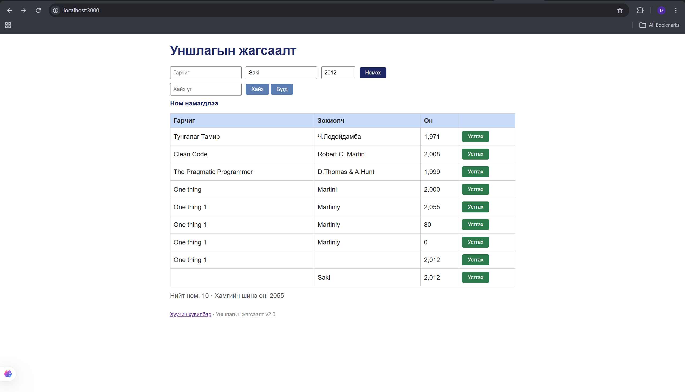

# BUG-03: Шаардлагатай талбарууд дутуу үед ном нэмэгдэж байна

**Орчин:** Уншлагын жагсаалт v2.0, Chrome болон `curl.exe`, Windows, Node.js v24.22.1, 2026-11-25/26. Browser-ийн хувилбар тэмдэглэгдээгүй.

**Урьдчилсан нөхцөл:** Апп ажиллаж байна. Шалгалт бүрийн өмнө аппыг шинээр асааж анхны төлөвт оруулна.

## Дахин гаргах алхам

### UI шалгалт

1. `http://localhost:3000` хаягийг нээнэ.
2. Гарчгийн талбарыг хоосон үлдээнэ.
3. Зохиолчид `Saki`, онд `2012` оруулна.
4. `Нэмэх` товчийг дарна.

### API шалгалт

1. `evidence/request-11.json` файлыг ашиглана. Уг JSON-д `title`, `author`, `year` талбарууд хоосон байна.
2. Дараах хүсэлтийг илгээнэ:

   ```powershell
   curl.exe --silent --show-error -i -X POST "http://localhost:3000/api/books" -H "Content-Type: application/json" --data-binary "@evidence/request-11.json"
   ```

**Хүлээгдэж байсан:** Гарчиг, зохиолч, он гурвуулаа заавал бөглөгдсөн байна. Дутуу эсвэл хоосон утгатай ном нэмэгдэхгүй, ойлгомжтой алдааны мэдээлэл гарна.

**Бодит үр дүн:** UI-д гарчиг хоосон үед ном нэмэгдсэн. API-д хоосон талбаруудтай хүсэлт `HTTP 201 Created`, `{"result":"OK","id":20}` буцаасан. Онгүй, зохиолчгүй, бүх талбар хоосон оролтууд мөн нэмэгдсэн гэж тэмдэглэгдсэн.

**Ноцтой байдал:** Major — шаардлагатай мэдээлэлгүй ном жагсаалтад үүсэж байна.

**Хавсралт:**  · `../evidence/bug-11-curl.txt`

**Олдсон аялал:** Couch Potato (хоосон/дутуу оролт), Saboteur (API)

**Тэмдэглэл:** Талбар тус бүрийг хоосон үлдээсэн хувилбаруудыг нэг шаардлагатай талбарын баталгаажуулалтын согогт нэгтгэв.
