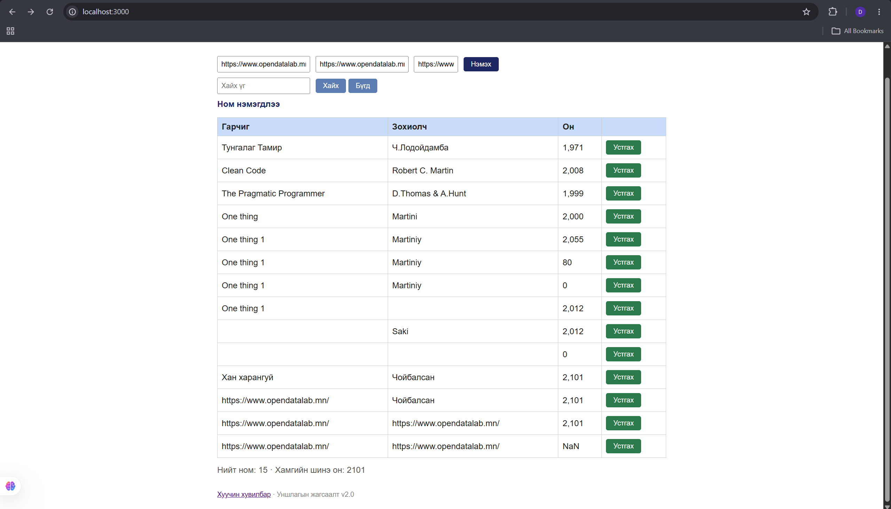

# BUG-04: Устгах товч аюултай үйлдлийн улаан өнгөтэй биш байна

**Орчин:** Уншлагын жагсаалт v2.0, Chrome, Windows, 2026-11-26. Browser-ийн хувилбар тэмдэглэгдээгүй.

**Урьдчилсан нөхцөл:** `node app.js` ажиллаж, номын жагсаалт харагдаж байна.

## Дахин гаргах алхам

1. `http://localhost:3000` хаягийг нээнэ.
2. Хүснэгтийн `Устгах` товчнуудын өнгийг шалгана.

**Хүлээгдэж байсан:** Аюултай үйлдлийн `Устгах` товч улаан өнгөтэй байна.

**Бодит үр дүн:** `Устгах` товч ногоон өнгөтэй харагдсан.

**Ноцтой байдал:** Cosmetic — товчны харагдах байдал зааврын өнгөний шаардлагад нийцэхгүй.

**Хавсралт:** 

**Олдсон аялал:** Supermodel (GUI)
