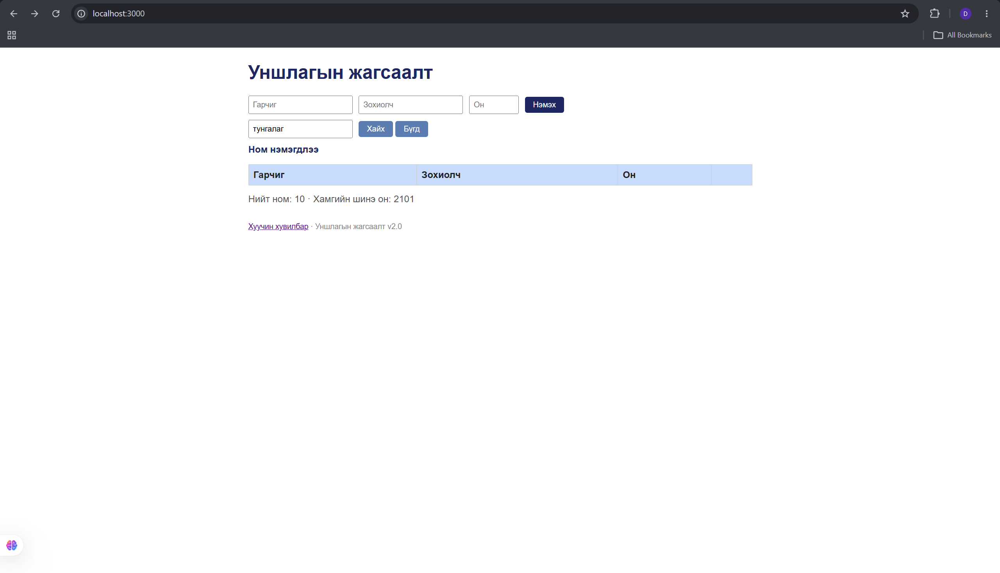

# BUG-05: Хайлт гарчиг дахь том, жижиг үсгийг ялгаж байна

**Орчин:** Уншлагын жагсаалт v2.0, Chrome, Windows, 2026-11-26. Browser-ийн хувилбар тэмдэглэгдээгүй.

**Урьдчилсан нөхцөл:** Аппыг шинээр асаасан; анхны номын жагсаалтад `Тунгалаг Тамир` гарчигтай ном байна.

## Дахин гаргах алхам

1. `http://localhost:3000` хаягийг нээнэ.
2. Хайлтын талбарт `тунгалаг` гэж жижиг үсгээр бичнэ.
3. `Хайх` товчийг дарна.

**Хүлээгдэж байсан:** Хайлт том, жижиг үсгийг ялгахгүй тул `Тунгалаг Тамир` ном илэрнэ.

**Бодит үр дүн:** Илэрц олдоогүй.

**Ноцтой байдал:** Major — гарчиг, зохиолчийн хайлт үсгийн хэмжээгээр зөрүүтэй үр дүн өгч байна.

**Хавсралт:** 

**Олдсон аялал:** Supermodel (GUI)
