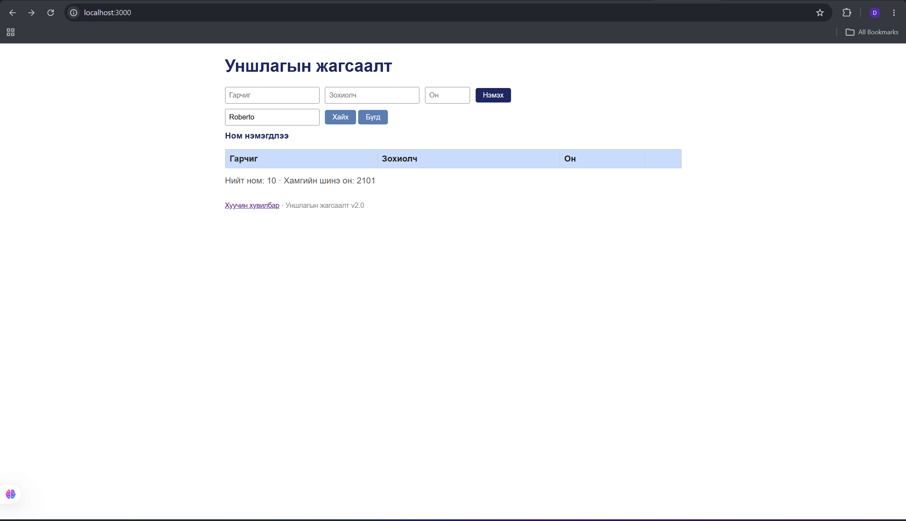

# BUG-08: Ном устгасны дараа «Ном нэмэгдлээ» гэсэн буруу мессеж гарч байна

*Орчин:* Уншлагын жагсаалт v2.0, Chrome 158.0.8127.88, Windows, Node.js v24.22.1, 2026-11-26

*Урьдчилсан нөхцөл:* `node app.js`-ийг шинээр асаасан (анхны 3 ном).

## Дахин гаргах алхам

1. http://localhost:3000 хаягийг нээнэ. Мессежийн хэсэг хоосон байна.
2. Clean Code номын мөрөнд байгаа Устгах товчийг дарна.
3. «Ном нэмэгдлээ» гэсэн буруу мессеж гарч байна.

*Хүлээгдэж байсан:* «Үйлдэл бүрийн дараах мессеж тухайн үйлдэлдээ тохирно» гэсэн дүрмийн дагуу устгах үйлдлийн дараа «Ном устгагдлаа» гэх мэт тохирох мессеж харагдана.

*Бодит үр дүн:* Clean Code хүснэгтээс устсан. Гэвч мессеж нь Ном нэмэгдлээ гэж гарсан.

*Ноцтой байдал:* Minor — үйлдэл өөрөө зөв биелж байгаа ч хэрэглэгчид хийсэн үйлдлийн талаар эсрэг утгатай мэдээлэл өгч байна. Хэрэглэгч ном санамсаргүй нэмэгдсэн гэж ойлгож болно.

*Хавсралт:* 

*Олдсон аялал:* Supermodel (GUI) — товч бүрийн дараах мессеж
